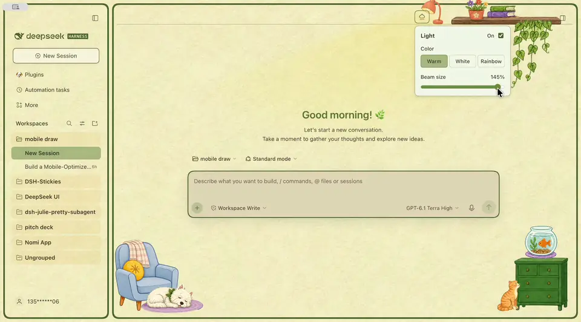

# My Cozy DSH

Transform your DSH workspace into a cozy, illustrated room with warm colors, a glowing desk lamp, leafy plants, and playful pets. Adjust the lighting, start a new session with a sleeping Westie, and keep a friendly orange cat by your side while you work.

## Installation

- **DSH Market:** find **My Cozy DSH**, then install or check for updates. Version **1.0.7** includes both fixes below.
- **Plugin manager:** add `my-cozy-dsh@1.0.7` from npm, or `github:juliiiiiiiu/my-cozy-dsh#v1.0.7` from GitHub.
- **Manual download:** download `my-cozy-dsh-1.0.7.tgz` from the GitHub release, extract it, and add the extracted package directory as a local bundle.

Restart DeepSeek Harness after replacing an installed version if the new controls do not appear. Market catalog labels and npm mirrors may take time to refresh.

## What's new in 1.0.7

- **Resizable conversation:** both native width handles work again. Messages and the composer resize together, and Harness remembers the selected width. The theme no longer forces a separate width or first-drag baseline.
- **Adaptive decorations:** the dog, chair, rug, cabinet, and fishbowl follow the composer and scale with available space. The left group hides below 90px of spare space; the right group hides below 80px. Each group returns when space is available again.
- **Lamp transparency:** open **Adjust light** to change **Transparency** from 0% to 100% for Warm, White, or Rainbow light. The setting persists after reopening. The release includes the continuous feathered light fix, with the composer excluded from the light field.

## Contents

This release contains the prebuilt client, its host entry point, bundle patch, icon, and English and Chinese locale files. Build sources are not included.

## License

MIT
