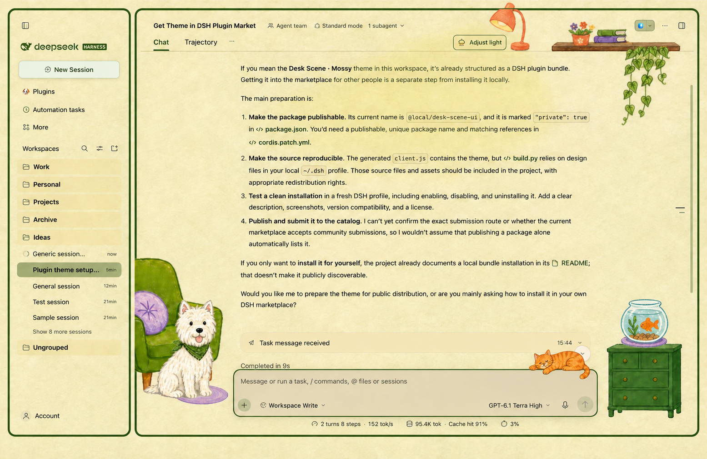

# My Cozy DSH

Transform your DSH workspace into a cozy, illustrated room with warm colors, a glowing desk lamp, leafy plants, and playful pets. Adjust the lighting, start a new session with a sleeping Westie, and keep a friendly orange cat by your side while you work.

## Installation

- **DSH Market:** find **My Cozy DSH**, then install or check for updates.
- **Plugin manager:** add `my-cozy-dsh@1.0.12` from npm, or `github:juliiiiiiiu/my-cozy-dsh#v1.0.12` from GitHub.
- **Manual install:** download the tarball with `npm pack my-cozy-dsh@1.0.12`, extract it, and add the extracted package directory as a local bundle.

Restart DeepSeek Harness after replacing an installed version if the new controls do not appear. Market catalog labels and npm mirrors may take time to refresh.

## What's new in 1.0.12

- **Orange-tabby star note:** after installing or updating, it appears as soon as the conversation settles and there is room above the composer. It waits while you're typing or a dialog is open. Earlier dismissals are reset. You can close it with × or Escape; it returns once after seven days, and a second dismissal hides it permanently.
- **Real GitHub stars:** **Add a star** uses the GitHub CLI login on the DSH host. If it fails or times out, the button becomes **Go to GitHub to star** and opens the repository on click. Only a confirmed star stops further reminders; opening the link alone does not.

## Retained from 1.0.11

- GitHub CLI uses an explicit `HTTPS_PROXY` if set, or the enabled manual macOS HTTPS proxy when GitHub is not excluded. Automatic proxy scripts and discovery are not evaluated. The theme does not change system settings.

## Retained from 1.0.8

- **Opaque dialogs in light mode:** Remote and other matching dialogs use the paper surface instead of showing their dark backdrop through the panel. The app shell still lets the wallpaper show through, and the new rule does not apply in dark mode.
- Includes all features and fixes from 1.0.7 below. See [CHANGELOG.md](CHANGELOG.md) for verification details.

## Retained from 1.0.7

- **Resizable conversation:** both native width handles work again. Messages and the composer resize together, and Harness remembers the selected width. The theme no longer forces a separate width or first-drag baseline.
- **Adaptive decorations:** the dog, chair, rug, cabinet, and fishbowl follow the composer and scale with available space. The left group hides below 90px of spare space; the right group hides below 80px. Each group returns when space is available again.
- **Lamp transparency:** open **Adjust light** to change **Transparency** from 0% to 100% for Warm, White, or Rainbow light. The setting persists after reopening. The release includes the continuous feathered light fix, with the composer excluded from the light field.

## Contents

This release contains the prebuilt client, its host entry point, bundle patch, icon, and English and Chinese locale files. Build sources are not included.

## License

MIT
