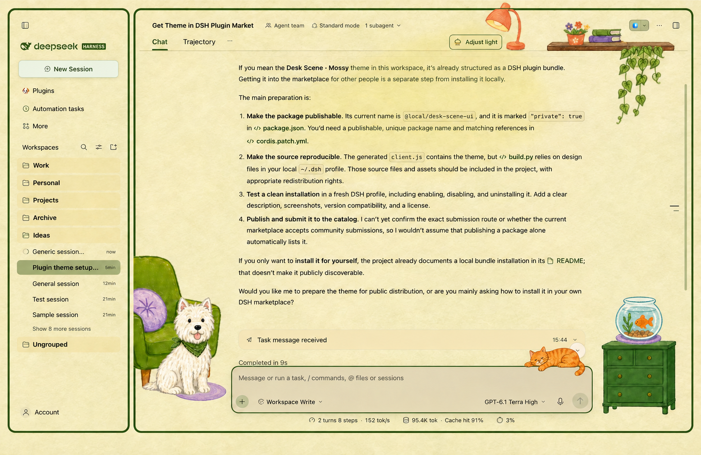

# My Cozy DSH

Transform your DSH workspace into a cozy, illustrated room with warm colors, a glowing desk lamp, leafy plants, and playful pets. Adjust the lighting, start a new session with a sleeping Westie, and keep a friendly orange cat by your side while you work.

## Installation

Install the repository as a bundle using DeepSeek Harness's plugin manager, or install the public package `my-cozy-dsh`. The bundle patch enables the matching client plugin. Restart the app after installation if needed.

## Contents

This release contains the prebuilt client, its host entry point, bundle patch, icon, and English and Chinese locale files. Build sources are not included.

## License

MIT
